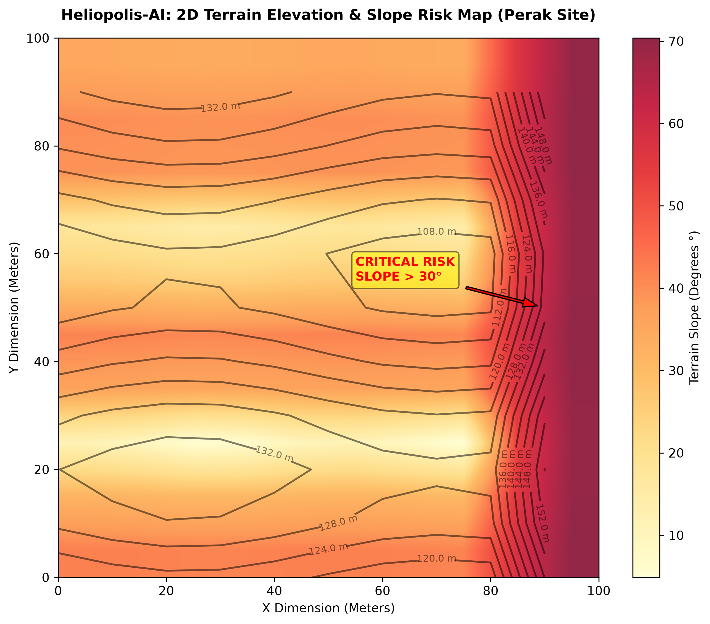
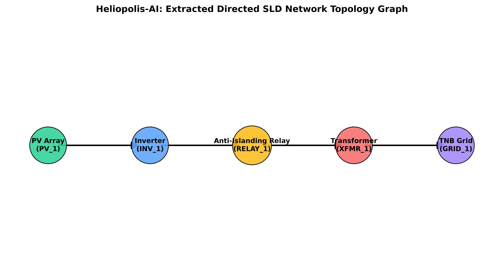

# Heliopolis-AI: Preliminary Solar Site Intelligence

[](https://github.com/lewbei/heliopolis-ai/actions)
[-orange.svg)](https://maicnexus.com/)

A prototype AI-assisted **preliminary** solar-site screening tool for Malaysia. Gemini Vision extracts data from scanned titles and single-line diagrams; deterministic Python produces limited arithmetic, topology and financial **screening** results. It does not certify legal title, grid compliance, investment suitability or scheme eligibility.


> **MAIC Nexus 2026 scope & provenance (updated 10 October 2026):**
> - All built-in land registry and terrain fixtures are **synthetic**; they are not verified land-office records, surveyed elevation grids or actual project permissions.
> - Uploaded-document OCR must fail closed if Gemini or critical evidence is unavailable. The app cannot silently replace an unreadable scan with a successful demo fixture.
> - A passing SLD topology graph is **not** protection-setting verification or TNB approval. A land title with no selected flags is **not** legally cleared.
> - LSS PPA is **illustrative**, not bankable. Historical NOVA/self-consumption results explicitly **withhold NPV and IRR** without customer load/export evidence. Solar ATAP has only a capacity precheck, not an export-offset financial model; its non-domestic inverter output cap and 10-year export-offset term cannot be ignored.
> - The preliminary 15% MW/MVA injection metric is a **heuristic**, not a TNB 15% limit or proof that batteries are required. Any utility study fees or approval time are scheme-dependent.
> - Tests establish particular software behaviors, **not** field extraction accuracy or time saved for actual solar developers.
>
> [Official Solar ATAP sources and MAQ/SMP method](qrspi/SOLAR_ATAP_OFFICIAL_RESEARCH.md) · [Regulatory sources, dates and limitations](qrspi/REGULATORY_SCOPE_2026.md) · [Read the updated MAIC pitch](PITCH_DECK.md) · [Official Solar ATAP guidance](https://www.seda.gov.my/reportal/atap/solar-atap-guidelines/) · [Official NEM/NOVA studies](https://www.seda.gov.my/reportal/nem/)
> **Authoritative pitch (10 October update):** The user's latest presentation is the **nine-page designed PDF** `Heliopolis_AI_MAIC_20261008_Main_Pitch (2)(1).pdf` (original SHA-256 `d70a11a9a7c0f6a9fb0cd9b15d9e46f2b225e2b172608cac7c11e3c4ad40620d`). [PITCH_DECK.md](PITCH_DECK.md) is its slide-by-slide TEXT transcription, and [the judge runbook](qrspi/JUDGE_DEMO_RUNBOOK.md) matches that nine-slide story. **The old committed `pitch_deck.pdf` is NOT the visually designed latest source**; a text-rendered GitHub Actions PDF is only a readable fallback, and the latest designed PDF must be uploaded separately before the repo PDF link is advertised as current. The earlier stale synthetic JSON report was removed; use the current Actions synthetic report artifact or run `python solar_agent.py`.

---

## MAIC public judge URL (Cloud Run configuration)

A minimal non-root [Dockerfile](Dockerfile), upload-excluding [.dockerignore](.dockerignore) and explicit server-side `HELIOPOLIS_DEMO_ONLY=1` mode are now available. In this mode both Streamlit pages use only synthetic examples: **no user document upload and no Google Vertex AI OCR call**. Deploying to an actual Google Cloud Run URL requires the project owner's authorized `gcloud` login, billing and user-managed public service account with no Vertex permissions.

See [public Cloud Run deployment and go/no-go checklist](qrspi/PUBLIC_CLOUD_RUN_DEMO_DEPLOYMENT.md). This is deployable configuration, **not a live website already hosted by GitHub Pages or ChatGPT**.

---

## MAIC live demo and scalability roadmap

The detailed [MAIC live-demo and scaling execution plan](qrspi/LIVE_DEMO_AND_SCALE_EXECUTION_PLAN_20261010.md) sequences the 2-acre source-title / 3.21 MWac capacity mismatch, Vertex AI proof, public synthetic-only Cloud Run demo, private OCR review service, judge fallback and 30/60/90-day customer scaling gates. **This is a plan, not a completed Cloud Run deployment or live Vertex benchmark.**

---

## MAIC live demonstration source documents

The original **synthetic Perak land-title PNG and 11 kV SLD PNG** shown on Slide 2 of the user's latest nine-page pitch have been recovered from the matching October 8 PowerPoint. The two binary images are available as an input ZIP supplied in the ChatGPT conversation; they have not been committed to this repository. See [the exact expected document fields, original image hashes, live Vertex OCR path, and offline negative-control demo instructions](qrspi/MAIC_LIVE_INPUT_DOCUMENTS.md).

Run `python scripts/extract_maic_demo_inputs.py /path/to/Heliopolis_AI_MAIC_20261008_Main_Pitch.pptx --output demo_inputs` on the original PPTX to recover the identical full-resolution PNGs. The script fails if the source does not match. The currently committed app is not the historical HOLD/financial output pictured on the original deck; the [capacity/footprint mismatch fix](https://github.com/lewbei/heliopolis-ai/issues/17) now makes current calculations respond to proposed AC capacity. Both 3.21 and 2.00 MWac still exceed the source two-acre footprint heuristic and withhold NPV/IRR. See the [tested current-code demo sequence](qrspi/JUDGE_DEMO_RUNBOOK.md#current-code-offline-source-demo) before presenting it on stage.

---

## Solar ATAP non-domestic (2026) — narrow source-grounded monthly checker

Solar ATAP is a **rooftop consumer solar** programme, not the default utility-scale LSS site prospecting mode. The project includes a pure [Solar ATAP monthly energy-component calculation](solar_atap_settlement.py) using only explicit, unverified/user-provided or synthetic inputs. It checks the published MAQ limit, import-energy cap, the preceding-month Average SMP, no credit rollover and the end of the ten-year offset term.

It **does not** estimate complete TNB bills or full ATAP NPV/IRR, and there is **no real consumer load dataset** shipped with the repository. Refer to [official source research and the required datasets](qrspi/SOLAR_ATAP_OFFICIAL_RESEARCH.md) and [the independent regression tests](tests/test_solar_atap_settlement.py). The original LSS Streamlit dashboard retains its ATAP **capacity-only** warning. A separate Solar ATAP monthly page is now available in the Streamlit sidebar, with an explicit synthetic demo and user-supplied monthly totals or fully time-aligned CSV input; it never produces a full bill, NPV or regulatory approval.

---

### Run the separate Solar ATAP monthly user interface

From the repository root:

    pip install -r requirements.txt
    streamlit run app.py

Use the sidebar page named **Solar ATAP Monthly**. Alternatively run it directly:

    streamlit run pages/1_Solar_ATAP_Monthly.py

The default screen asks for real, user-provided values (NOT assumed). Select **Clearly synthetic MAIC judge fixture** to demonstrate the known January 2026 historical SMP example; it is not current SMP or customer evidence. Uploading a CSV uses STRICT full-period coverage with headers:

    timestamp_myt,load_kwh,pv_kwh

Use 30- or 60-minute rows in Malaysia local time for every interval of the chosen billing period, starting at 00:00. Omitted, repeated, shifted or non-finite values fail closed. Use **only approved/anonymized customer data**, and do not expose personally identifying utility-account details in a public Streamlit deployment.

The form requires the billing month, **preceding** Single Buyer Average SMP month and rate, AC kW, customer MD, days, imported/exported energy or matched interval load/PV, and a contract-month assumption. It produces **energy-component-only** results and a downloadable preliminary audit. Contract month is NOT a signed commissioning date.

### Record a fair three-method evaluation

The [paired B0/B1/Heliopolis evaluation harness](benchmark_evidence.py) computes false clearances, critical-issue flags, abstentions, coverage and measured cost/latency **only after genuine model outputs and independent labels have been supplied**. To create an empty input sheet, run:

    python benchmark_evidence.py --template PRIVATE_matched_results.csv

Refer to [the evaluation runbook](qrspi/BENCHMARK_RUNBOOK.md). There is no real-document accuracy, speedup or commercial traction claim from the synthetic unit tests.

### Verify live OCR only with authorized source images

The app requires permission before transmitting uploaded title/SLD images to Google. For a privacy-preserving local test, run:

    python verify_live_ocr.py --title /approved/local/title.png --confirm-cloud-processing

Or use the SLD variant. The script refuses missing authorization/credentials and emits **sanitized outcome metadata only**. The actual extraction still needs a human reviewer to compare all fields against the original. Read the [live OCR and privacy runbook](qrspi/LIVE_OCR_RUNBOOK.md). **No live Gemini accuracy or field validation has been performed in this repository.**


---

## 🚀 The Core Innovation: Neural-Symbolic Hybrid Design

Most AI projects in this space are simple "prompt wrappers" that are prone to hallucinating complex engineering specifications, land conversions, and financial IRR models. **Heliopolis-AI separates perception from reasoning so that all engineering math, unit conversions, and graph audits are deterministic and auditable:**

```
                        [ Scanned Deeds / SLDs ]
                                    │
                         ( Multimodal Vision OCR )
                         └──► Gemini Vision (Google GenAI / Vertex AI)
                                    │
                         ( Programmatic Symbolic Solver )
                         ├──► Land Share Arithmetic & Imperial Unit Converter
                         ├──► 2D Spatial Slope Finite Differences
                         ├──► NetworkX Preliminary Topology Checks
                         └──► Newton-Raphson Financial Solvers
                                    │
                       [ Draft SEDA & TNB Planning Fields ]
```

1. **Perception (Multimodal):** Uses **Gemini Vision** (Google GenAI / Vertex AI) to extract structured fields from scanned land titles and electrical single-line diagrams.
2. **Reasoning (Symbolic):** Delegates all unit conversions, co-owner shares, modeled drawing connectivity, and cash flows to **deterministic, mathematical Python engines**.

---

## 📊 Visual Analytics & Performance

Heliopolis-AI generates high-resolution visual plots for pitch decks and technical review:

### A. 2D Terrain Elevation & Slope Risk Map (Perak Site)
Using 2D spatial finite differences ($\theta_{deg} = \arctan(\sqrt{f'_x^2 + f'_y^2}) \times 180/\pi$), Heliopolis-AI analyzes topography contours and automatically applies earthworks cost premiums and safety warnings for severe slopes ($>30^\circ$).



### B. Extracted Single-Line Diagram Topology Graph
Uses spatial $\epsilon$-neighbor matching to extract a directed drawing graph for **preliminary**, limited connectivity review; it cannot verify TNB ESAG, protection settings or MS IEC 1837 compliance. The primary **LV** profile recognizes PV → inverter → AC switch/PV meter → grid without requiring a separate MV-style transformer or external relay; an absent explicit anti-islanding annotation triggers human review. See [TNB Appendix B LV profile and negative-control demo](qrspi/PRIMARY_LV_SLD_SCOPE.md).



---

## ⚡ Key Technical Features

* **Multimodal OCR + Symbolic Reasoning:** Gemini Vision extracts text and SLD symbols; all math, unit conversion, graph routing, and finance run in deterministic Python.
* **Scale-Invariant Epsilon:** Programmatically calculates matching thresholds as $15\%$ of average inverter bounding box widths, working across A4 to A0 drawings.
* **Junction-Dot Aware SLD Resolver:** Splits wire segments at detected junction dots and ignores plain line crossings, preventing short-circuit hallucinations.
* **TNB Substation Capacity Validator:** Audits peak AC solar output against the local substation limits. The 15% comparison is an **illustrative MW/MVA flag**, not a utility limit. Four-hour LFP BESS sizing is an explicitly selected what-if; actual requirement and design need a network study.
* **Scenario-Based Financial Model:** LSS PPA produces an illustrative economic sensitivity. Historical NOVA and self-consumption show capacity/yield/LCOE but **withhold NPV/IRR** without customer interval demand/export and contract evidence.
* **Newton-Raphson IRR Solver:** For the illustrative LSS PPA case, solves IRR iteratively. No IRR is reported for customer-offset scenarios without supporting consumption data.

---

## Legal and intellectual-property qualification

This prototype has **not** received legal clearance, title approval, TNB study approval or a professional freedom-to-operate opinion. Earlier patent-search notes are preliminary research only. Confirm applicability with qualified advisers before any commercial use.

---

## 📂 Repository Directory Structure

* `solar_agent.py`: Core executable backend agent (legal parser, civil slope gradient, SLD topology resolver, yield engine, form pre-filler).
* `solar_visualizer.py`: Matplotlib plotting script for terrain contours and NetworkX SLD graphs.
* `heliopolis_ocr.py`: Gemini Vision OCR wrapper for scanned land titles and SLD images.
* `app.py`: Streamlit frontend.
* `app_config.py`, `app_components.py`, `app_logic.py`: Modular UI configuration, HTML components, and business logic.
* `tests/`: Automated unit testing folder (see CI for latest test results).
* `qrspi/`: Complete Quality & QRSPI Compliance portfolio:
  * `QUESTION_CONTRACT.md`: Measurable success criteria contract.
  * `RESEARCH_PACK.md`: Legal (NLC 1965) and Grid (TNB/SEDA) compliance facts.
  * `DESIGN_OPTIONS.md`: Architectural trade-offs and choices.
  * `STRUCTURE_OUTLINE.md`: Map of files, classes, and expected artifacts.
  * `ROOT_PLAN.md`: Complete mathematical and civil engineering formulas.
  * `TEST_OUTPUTS.md`: Verification execution logs.
  * `PROJECT_SUMMARY.md`: **Mandatory** text for the MAIC Nexus portal submission.
  * `AI_USAGE_DISCLOSURE.md`: **Mandatory** text for the MAIC Nexus portal submission.

---

## 🚀 How to Use Heliopolis-AI

### 1. Setup Environment
Install the required Python packages:
```bash
pip install -r requirements.txt
```
Or manually:
```bash
pip install numpy networkx matplotlib pydantic pytest streamlit plotly google-genai python-dotenv Pillow
```

### 2. Configure Gemini Credentials (Optional)
To run OCR on scanned land titles or SLD images, copy `.env.example` to `.env` and add your credentials:
```bash
cp .env.example .env
```
```bash
# Option 1: Google AI Studio API key
GEMINI_API_KEY=your_key_here

# Option 2: Vertex AI
GOOGLE_CLOUD_PROJECT=your-gcp-project-id
GOOGLE_CLOUD_LOCATION=us-central1
```
Without credentials, the **explicit synthetic/demo path** remains available. If you upload a document, OCR failure now returns a review/error condition rather than silently replacing it with a synthetic result.

### 3. Quick CLI Run
Run the full backend pipeline on a selected demo site:
```bash
python solar_agent.py
```
This generates `solar_assessment_report.json`, which contains (all outputs are illustrative unless independently verified):
* `land_title_analysis` — parsed title, owners, shares, and legal status.
* `sld_topology_analysis` — directed graph and TNB grid-code audit.
* `technical_financial_feasibility` — capacity, yield, LCOE, scenario and an explicit financial status (with NPV/IRR null unless sufficient inputs exist).
* `regulatory_manifest` — pre-filled SEDA and TNB application fields.

You can override the financial scenario via an environment variable:
```bash
HELIOPOLIS_SCENARIO=lss_ppa python solar_agent.py      # utility PPA
HELIOPOLIS_SCENARIO=c_i_nem python solar_agent.py      # C&I/NOVA illustrative sensitivity (not Solar ATAP)
HELIOPOLIS_SCENARIO=self_consumption python solar_agent.py  # premium self-consumption
```

### 4. Interactive Streamlit App
Launch the web UI:
```bash
streamlit run app.py
```
Then open the URL printed in the terminal (usually `http://localhost:8501`).

In the sidebar, fill in:
1. **Site Mode** — choose a synthetic preset or a synthetic representative Malaysian site from the demo registry.
2. **Land Attributes** — Title No, Lot No, State, Zoning, and land area in *Ekar / Rood / Pole*.
3. **Legal Restrictions** — tick any Caveat, Charge, or Malay Reserve flags.
4. **Project Company** — the company that will file SEDA/TNB applications (defaults to an explicitly labeled fictional developer).
5. **Technical Specifications** — slope profile, proposed AC capacity (MWac), and upstream substation limit (MVA).
6. **Financial Scenario** — pick LSS PPA, illustrative C&I/NEM NOVA sensitivity (not Solar ATAP), or Self-Consumption / Premium tariff.
7. **Scanned Document OCR** (optional) — upload a land-title scan and/or SLD scan to use Gemini Vision instead of the form values.

The dashboard then shows:
* Legal share arithmetic and preliminary flags requiring professional review (not a POA or lease determination).
* 2D terrain slope risk map.
* Connection-class-aware preliminary SLD drawing review (LV/MV; UNKNOWN/HV remain review-required), not inverter certification or TNB approval.
* Capacity, yield, CAPEX and LCOE for illustrative cases; NPV/IRR/payback only for the indicative LSS PPA scenario, never unsupported NOVA/ATAP credits.
* Draft planning fields and a scheme-dependent study screen (not filed SEDA/TNB applications).

### 5. Generate Plots
After running `solar_agent.py`, generate the pitch-deck plots:
```bash
python solar_visualizer.py
```
Output appears in `qrspi/plots/`:
* `perak_slope_risk_contour.png`
* `sld_topology_flow_graph.png`

### 6. Run the Test Suite
```bash
pytest tests/
```
Run the complete suite for the exact checked-out revision. Baseline commit `8b2562a68be3d6e2a8b375d99b0462f28736b965` passed 213 offline tests; later workflow tests add coverage without constituting live OCR or field-validation evidence.

---

## 📄 Understanding `solar_assessment_report.json`

| Section | What it tells you |
|---|---|
| `land_title_analysis` | Title and lot numbers, state/district/mukim, land area in imperial and metric, owners with fractional shares, controlling-interest check, caveats/charges/reserve flags, and preliminary review flags (`Needs Legal Review` / `Flagged/Risky`). |
| `sld_topology_analysis` | Node/edge count of the directed SLD graph, graph edges, and the TNB compliance result (`anti_islanding_relay_present`, `grid_path_valid`). |
| `technical_financial_feasibility` | DC capacity (MWp), annual yield (MWh/year), base and adjusted CAPEX, LCOE (RM/kWh), PPA/displaced tariff (RM/kWh), selected scenario, NPV (RM), IRR (%), and payback (years). |
| `regulatory_manifest` | Pre-filled SEDA application fields, TNB grid-connection request, and programme-appropriate study screen (does not universally mandate NEMAS at 72 kWac). |

---

## 🗂️ Data & Assumptions

* `real_malaysian_sites_registry.json` is a **synthetic demo registry** of representative Malaysian solar sites. It is used to demonstrate the pipeline without live e-Tanah or land-office integrations.
* `generate_precise_terrain()` produces **synthetic elevation grids** calibrated to a target mean slope. Real project due diligence would replace this with SRTM DEM, Lidar, or survey contour data.
* Default financial assumptions (tariff, WACC, degradation, CAPEX) are illustrative. A production deployment should load scenario-specific assumptions (LSS PPA, historical C&I/NOVA reference, or self-consumption load-dependent screening).

---

## 📚 Sources & Market Benchmarks

The financial scenario tariffs and technical parameters are grounded in publicly available Malaysian clean-energy market data:

* **LSS PPA tariff (~RM 0.17/kWh):** Based on the LSS PETRA 5 / LSS5 average award tariff reported in 2024. See [Mordor Intelligence — Malaysia Solar Energy Market](https://www.mordorintelligence.com/industry-reports/malaysia-solar-energy-market) and [The Star](https://www.thestar.com.my).
* **Industrial / C&I displaced tariff (~RM 0.37/kWh):** Derived from reported Peninsular Malaysia low-voltage industrial tariffs in [Ember — Solar and grid flexibility for Malaysia](https://ember-energy.org/app/uploads/2024/10/Report-Solar-and-grid-flexibility-critical-for-Malaysias-future.pdf).
* **Solar LCOE range (~RM 0.15–0.29/kWh):** BloombergNEF, *Malaysia: A Techno-Economic Analysis of Power Generation* (April 2025) — [PDF](https://assets.bbhub.io/professional/sites/24/Malaysia-A-Techno-Economic-Analysis-of-Power-Generation.pdf).
* **Historical NEM / NOVA and Solar ATAP (distinct schemes):** [SEDA Malaysia NEM portal](https://www.seda.gov.my/reportal/nem) and [myTNB NEM Application](https://www.mytnb.com.my/renewable-energy/nem-application).
* **BESS deferment and system-access charges:** [IEA-PVPS Malaysia country profile](https://iea-pvps.org/about-iea-pvps/members/malaysia) and BloombergNEF report above.
* **Weather data:** `real_malaysian_weather.json` contains historical GHI and temperature values derived from satellite-based solar resource datasets (e.g. [Open-Meteo](https://open-meteo.com)) for Malaysian states.
